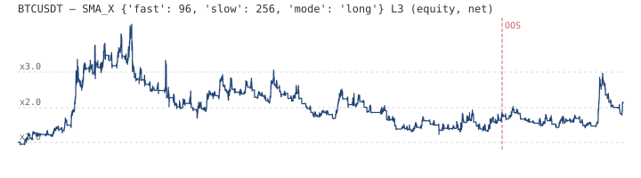
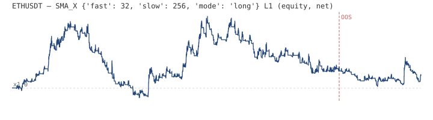
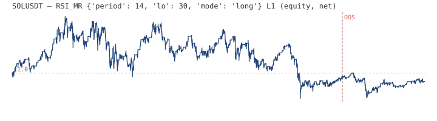

# SANDBOX OVERFIT — 3 tài sản (BTC/ETH/SOL perp, 15m, ~2 năm)

> **Trạng thái: SANDBOX, KHÔNG phải evidence.** Chọn cấu hình theo lợi nhuận **in-sample thuần** (có phí taker 5bp + trượt 1bp + funding ~1bp/8h), overfit cố ý theo chỉ đạo owner. Cột OOS là chẩn đoán 'thật sự còn lại bao nhiêu' — **không** dùng để chọn. Đòn bẩy L không mô hình liquidation.

## BTCUSDT — 71863 nến 15m, 2024-09-01 → 2026-09-19

Buy & Hold: IS 33.1% | OOS 3.5%

| # | Họ | Tham số | L | IS Net | IS CAGR | IS Sharpe | IS MaxDD | Trades | Win% | **OOS Net** | OOS Sharpe |
|---|---|---|---|---|---|---|---|---|---|---|---|
| 1 | SMA_X | `{"fast":96,"slow":256,"mode":"long"}` | 3 | 81.8% | 43.9% | 0.86 | 72.3% | 243 | 32% | **17.6%** | 0.89 |
| 2 | SMA_X | `{"fast":96,"slow":256,"mode":"long"}` | 2 | 75.7% | 41.0% | 0.86 | 53.8% | 243 | 33% | **14.6%** | 0.89 |
| 3 | RSI_MR | `{"period":42,"lo":25,"mode":"both"}` | 2 | 67.6% | 37.0% | 0.80 | 78.6% | 5 | 50% | **-59.6%** | -2.52 |
| 4 | RSI_MR | `{"period":42,"lo":25,"mode":"both"}` | 1 | 55.1% | 30.7% | 0.80 | 51.6% | 5 | 50% | **-34.5%** | -2.52 |
| 5 | RSI_MR | `{"period":42,"lo":25,"mode":"long"}` | 2 | 47.8% | 26.9% | 0.71 | 76.6% | 5 | 67% | **-36.0%** | -1.30 |
| 6 | SMA_X | `{"fast":96,"slow":256,"mode":"long"}` | 1 | 43.9% | 24.9% | 0.86 | 29.1% | 243 | 34% | **8.6%** | 0.89 |
| 7 | RSI_MR | `{"period":42,"lo":25,"mode":"long"}` | 1 | 41.5% | 23.6% | 0.71 | 49.7% | 5 | 67% | **-18.2%** | -1.30 |
| 8 | SMA_X | `{"fast":96,"slow":256,"mode":"both"}` | 1 | 26.6% | 15.4% | 0.54 | 47.1% | 243 | 36% | **10.7%** | 0.84 |
| 9 | RSI_MR | `{"period":42,"lo":25,"mode":"both"}` | 3 | 26.2% | 15.2% | 0.80 | 91.3% | 5 | 50% | **-76.5%** | -2.52 |
| 10 | SMA_X | `{"fast":64,"slow":384,"mode":"long"}` | 1 | 15.0% | 8.9% | 0.43 | 42.0% | 215 | 34% | **-3.6%** | -0.21 |

## ETHUSDT — 71863 nến 15m, 2024-09-01 → 2026-09-19

Buy & Hold: IS -4.7% | OOS 10.2%

| # | Họ | Tham số | L | IS Net | IS CAGR | IS Sharpe | IS MaxDD | Trades | Win% | **OOS Net** | OOS Sharpe |
|---|---|---|---|---|---|---|---|---|---|---|---|
| 1 | SMA_X | `{"fast":32,"slow":256,"mode":"long"}` | 1 | 26.3% | 15.3% | 0.54 | 53.5% | 333 | 32% | **-7.4%** | -0.35 |
| 2 | SMA_X | `{"fast":24,"slow":256,"mode":"long"}` | 1 | 22.4% | 13.1% | 0.50 | 46.7% | 399 | 32% | **-5.0%** | -0.17 |
| 3 | DONCH | `{"n":192,"m":192,"mode":"long"}` | 1 | 22.4% | 13.1% | 0.50 | 53.2% | 189 | 21% | **-13.6%** | -0.82 |
| 4 | SMA_X | `{"fast":96,"slow":256,"mode":"long"}` | 1 | 21.6% | 12.6% | 0.49 | 58.0% | 241 | 40% | **-4.8%** | -0.16 |
| 5 | SMA_X | `{"fast":48,"slow":256,"mode":"long"}` | 1 | 18.9% | 11.2% | 0.46 | 46.2% | 297 | 39% | **-4.6%** | -0.15 |
| 6 | SMA_X | `{"fast":16,"slow":256,"mode":"long"}` | 1 | 17.0% | 10.0% | 0.44 | 52.6% | 459 | 29% | **-7.9%** | -0.38 |
| 7 | SMA_X | `{"fast":64,"slow":256,"mode":"long"}` | 1 | 16.6% | 9.8% | 0.43 | 50.6% | 269 | 36% | **2.3%** | 0.34 |
| 8 | SMA_X | `{"fast":8,"slow":256,"mode":"long"}` | 1 | 16.2% | 9.6% | 0.43 | 45.2% | 661 | 29% | **-2.2%** | 0.02 |
| 9 | DONCH | `{"n":192,"m":96,"mode":"long"}` | 1 | 14.8% | 8.8% | 0.41 | 56.3% | 261 | 23% | **-10.7%** | -0.72 |
| 10 | SMA_X | `{"fast":32,"slow":256,"mode":"long"}` | 2 | 14.2% | 8.4% | 0.54 | 79.8% | 333 | 32% | **-18.4%** | -0.35 |

## SOLUSDT — 71863 nến 15m, 2024-09-01 → 2026-09-19

Buy & Hold: IS -35.6% | OOS 27.9%

| # | Họ | Tham số | L | IS Net | IS CAGR | IS Sharpe | IS MaxDD | Trades | Win% | **OOS Net** | OOS Sharpe |
|---|---|---|---|---|---|---|---|---|---|---|---|
| 1 | RSI_MR | `{"period":14,"lo":30,"mode":"long"}` | 1 | -3.9% | -2.4% | 0.27 | 58.2% | 402 | 78% | **-6.0%** | -0.18 |
| 2 | BOLL_MR | `{"period":40,"k":3.0,"mode":"long"}` | 1 | -8.8% | -5.5% | 0.20 | 64.7% | 239 | 75% | **-11.3%** | -0.59 |
| 3 | RSI_MR | `{"period":14,"lo":30,"mode":"both"}` | 1 | -12.2% | -7.6% | 0.32 | 59.9% | 402 | 64% | **-36.3%** | -1.58 |
| 4 | SMA_X | `{"fast":32,"slow":96,"mode":"long"}` | 1 | -16.0% | -10.1% | 0.08 | 60.2% | 669 | 36% | **50.6%** | 2.56 |
| 5 | DONCH | `{"n":192,"m":192,"mode":"long"}` | 1 | -20.2% | -12.9% | 0.03 | 61.5% | 189 | 19% | **36.4%** | 1.98 |
| 6 | SMA_X | `{"fast":24,"slow":256,"mode":"long"}` | 1 | -20.4% | -13.0% | 0.02 | 65.0% | 391 | 34% | **35.3%** | 1.95 |
| 7 | TSMOM | `{"lb":768,"mode":"long"}` | 1 | -20.6% | -13.1% | 0.00 | 55.7% | 867 | 23% | **2.8%** | 0.37 |
| 8 | BOLL_MR | `{"period":40,"k":3.0,"mode":"both"}` | 1 | -25.6% | -16.5% | 0.20 | 75.5% | 240 | 60% | **-43.9%** | -2.11 |
| 9 | RSI_MR | `{"period":42,"lo":25,"mode":"long"}` | 1 | -25.9% | -16.7% | -0.07 | 65.6% | 10 | 64% | **13.1%** | 2.69 |
| 10 | DONCH | `{"n":384,"m":192,"mode":"long"}` | 1 | -26.5% | -17.1% | -0.15 | 57.8% | 139 | 21% | **40.9%** | 2.43 |

---

## Lời cảnh báo (đọc trước khi 'kiểm tra' gì đó với những con số này)

1. **Overfit cố ý**: mỗi tài sản chạy 444 cấu hình, chọn 1 cái đẹp nhất IS — số IS gần như chắc chắn không lặp lại tương lai.
2. **OOS cột** cho thấy khoảng cách: đây là byproduct có ý nghĩa nhất của sandbox — chênh IS vs OOS = thước đo mức 'khủng' là ảo.
3. Chi phí xấp xỉ, **không có funding thực theo thời gian**, không liquidation với L>1, không slippage theo depth.
4. Không fold discipline / DSR / PBO / trial accounting — cố tình, để so sánh với quy trình evidence-first của factory.
5. Không đăng ký `CYCLE_REGISTRY.json`; không đụng ledger của cycle nào.

Tổng số cấu hình đã thử (đếm thử nghiệm): 1332 (148 signal × 3 đòn bẩy × 3 tài sản).

Đầy đủ: `out/results_all.csv`; equity top-1 từng mã: `out/top_equity_*.csv`.
